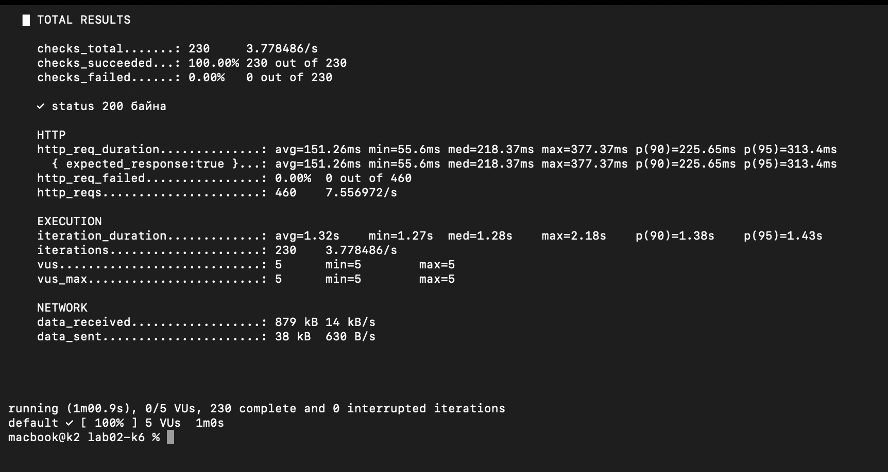
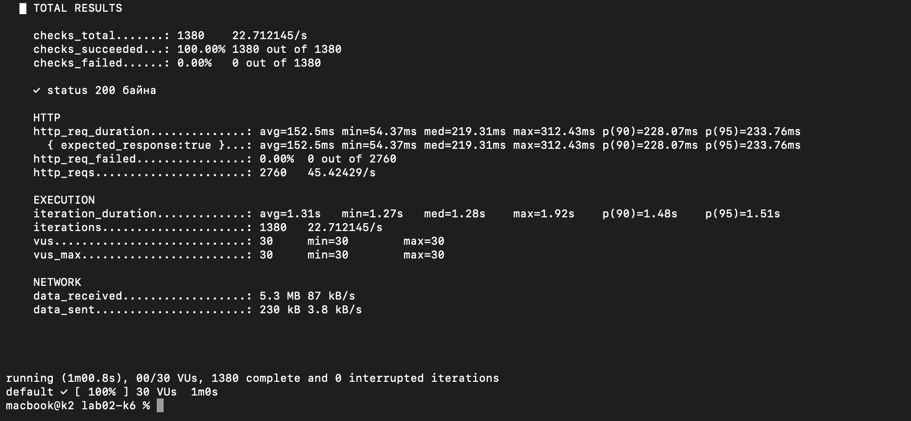
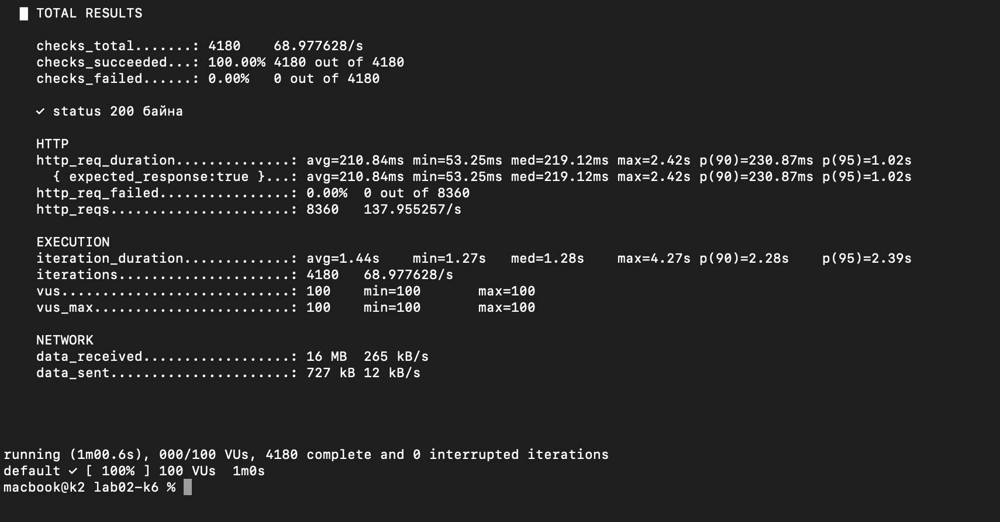
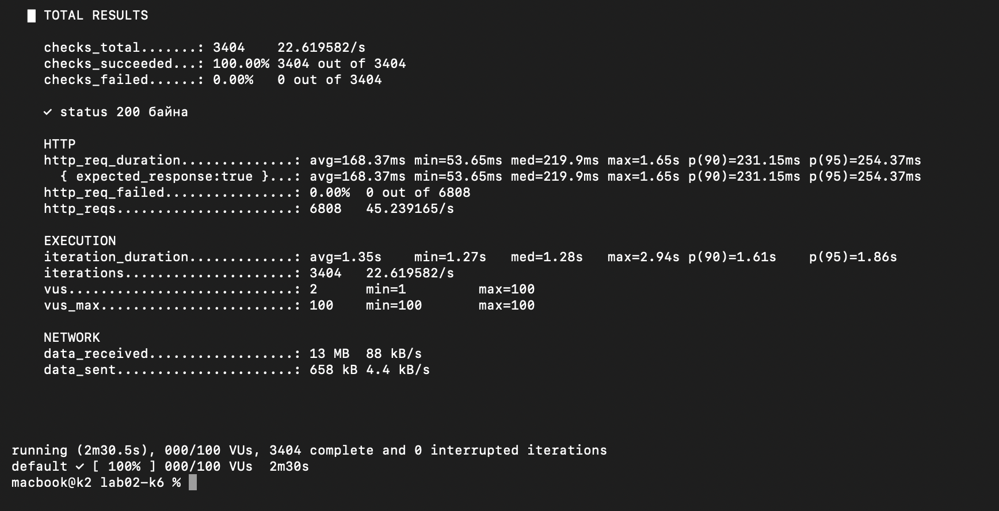
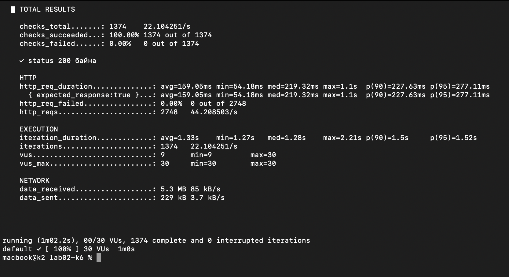
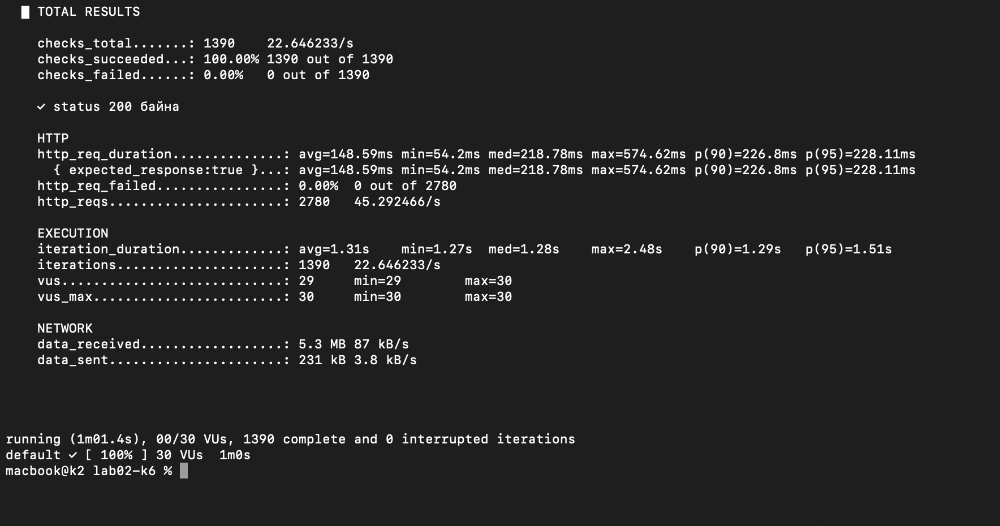

# Лаб 2: Гүйцэтгэлийн хэмжүүрийг k6-аар хэмжих (F.CSA313)

**Оюутан:** А.Ууганбаяр (B242270014)

Энэ лабораторид k6 ашиглан latency (p90/p95), throughput, error rate хэмжүүрийг бодитоор хэмжиж, ачаалал өсөхөд гүйцэтгэл хэрхэн өөрчлөгдөхийг ажиглана.

## Ёс зүй
Load тестийг зөвхөн зөвшөөрөгдсөн бай руу хийсэн: **https://test.k6.io** болон өөрийн компьютер дээрх **локал сервер** (`server.js`). `lib.js` нь өөр хаяг өгвөл скриптийг ажиллахаас өмнө зогсооно.

## Файлууд
| Файл | Зорилго |
|---|---|
| `lib.js` | Бай (TARGET)-ын хаягийг шалгадаг нийтлэг хэсэг |
| `script.js` | Алхам 2: baseline тест (vus/duration командаас солигдоно) |
| `stages.js` | Алхам 3: ачааллыг шатлан өсгөх |
| `thresholds.js` | Алхам 4: SLO-г threshold болгон шалгах (PASS/FAIL) |
| `server.js` | Алхам 5: локал сервер (`/` хурдан, `/slow` 100 мс удаан) |
| `scripts/run-levels.sh` | 5/30/100 VU түвшнийг тусад нь ажиллуулж гаралтыг хадгална |
| `scripts/make-table.py` | `results/` дахь гаралтаас хүснэгт гаргана |
| `results/` | k6-ийн бүтэн текст гаралтууд |
| `screenshots/` | Summary гаралтын дэлгэцийн зургууд |

## Ажиллуулах
```bash
brew install k6
k6 version

k6 run script.js | tee results/run-05vu.txt
bash scripts/run-levels.sh
k6 run stages.js | tee results/stages.txt
python3 scripts/make-table.py

k6 run -e SLO_P95_MS=<тоо> thresholds.js | tee results/threshold-pass.txt
k6 run -e SLO_P95_MS=50    thresholds.js | tee results/threshold-fail.txt

node server.js
bash scripts/run-levels.sh local http://localhost:3000
ENDPOINT=/slow bash scripts/run-levels.sh slow http://localhost:3000
```

## Хэмжилтийн үр дүн (bай: https://test.k6.io)
5 / 30 / 100 VU түвшин тус бүрийг `--duration 1m`-ээр **тусад нь** ажиллуулсан (`scripts/run-levels.sh`). Бүтэн гаралт нь `results/run-*.txt`-д хадгалагдсан, доорх хүснэгтийг `scripts/make-table.py` тэдгээрээс автоматаар гаргасан.

| VU | avg (мс) | p90 (мс) | p95 (мс) | Throughput (req/с) | Нийт хүсэлт | Error rate (%) | Эх файл |
|---:|---:|---:|---:|---:|---:|---:|---|
| 5 | 151.26 | 225.65 | 313.40 | 7.56 | 460 | 0.00 | `results/run-05vu.txt` |
| 30 | 152.50 | 228.07 | 233.76 | 45.42 | 2760 | 0.00 | `results/run-30vu.txt` |
| 100 | 210.84 | 230.87 | 1020.00 | 137.96 | 8360 | 0.00 | `results/run-100vu.txt` |

Нэмэлт: хамгийн анхны 30 секундын baseline (5 VU) нь avg 142.09 мс, p90 226.54 мс, p95 228.59 мс, 7.46 req/с, error rate 0.00% гарсан. Энэ файл нь git түүхэнд (commit `2cd034f`) үлдсэн.

### Дэлгэцийн зураг




### Stages (5 -> 30 -> 100 -> 0 VU) ажиллуулалт
`stages.js` нь тестийн төгсгөлд зөвхөн нэг нэгтгэсэн summary өгдөг тул түвшин тус бүрийн тоог дээрх тусдаа ажиллуулалтаас авсан. Stages-ийн нэгтгэсэн үр дүн (`results/stages.txt`):

```
    http_req_duration..............: avg=168.37ms min=53.65ms med=219.9ms max=1.65s p(90)=231.15ms p(95)=254.37ms
    http_req_failed................: 0.00%  0 out of 6808
    http_reqs......................: 6808   45.239165/s
```



## Thresholds ба SLO
**SLO:** `p95 < 470 мс` ба `error rate < 1%`.

**Үндэслэл:** 470 мс нь өөрийн baseline-ийн p95 (5 VU, 313.40 мс, `results/run-05vu.txt`) x 1.5 юм. Baseline-ийн хоёр ажиллуулалт (228.59 ба 313.40 мс) бие биенээсээ ялгаатай байсан тул сүлжээний хэлбэлзлийг багтаах 50%-ийн нөөцтэйгээр сонгосон. Error rate-ийн 1%-ийн босго нь baseline дээр 0.00% байсныг үндэслэсэн.

| Ажиллуулалт | SLO (p95) | Хэмжсэн p95 | Error rate | Үр дүн | Файл |
|---|---:|---:|---:|---|---|
| PASS (30 VU) | < 470 мс | 277.11 мс | 0.00% | PASS | `results/threshold-pass.txt` |
| FAIL (30 VU, санаатайгаар хатуу) | < 50 мс | 228.11 мс | 0.00% | FAIL | `results/threshold-fail.txt` |




## Дүгнэлт
Ачаалал 5-аас 30 VU болоход throughput 7.56-аас 45.42 req/с болж (6 дахин) VU-ийн тоотой шулуун харьцаагаар өссөн бол дундаж latency 151 мс-ээс 153 мс болж бараг өөрчлөгдөөгүй. 100 VU дээр throughput 137.96 req/с болж өссөн боловч 30 VU-ийн үр дүнгээс шулуун харьцаагаар хүлээгдэх ≈151 req/с-ээс ~9% бага байсан нь систем ханалтад ойртож эхэлснийг харуулж байна. Хамгийн их өөрчлөгдсөн нь tail latency: p95 нь 30 VU дээр 233.76 мс байсан бол 100 VU дээр 1.02 с болж 4.4 дахин өссөн, харин дундаж 38% (152.50 -> 210.84 мс) ба p90 (228 -> 231 мс) бараг өөрчлөгдөөгүй. Иймээс дундаж утга ачааллын доройтлыг нууж байх тул p95/p99 зэрэг percentile хэмжүүр хэрэгтэй гэсэн лекцийн ойлголт батлагдсан. "Нэгж хэрэглэгчийн туршлага" 30 ба 100 VU-ийн хооронд муудаж эхэлсэн боловч би зөвхөн гурван цэг хэмжсэн тул яг аль VU дээр эхэлснийг тодорхойлж чадахгүй. Error rate бүх түвшинд 0.00% байсан тул (лекцийн POFOD-ийн аналог) системийн хүртээмж алдагдаагүй, зөвхөн хариуны хурд муудсан. 5 VU-ийн p95 (313 мс) нь 30 VU-ийнхээс (234 мс) өндөр гарсан бөгөөд анхны 30 секундын baseline 228.59 мс байсан тул энэ нь ачааллын нөлөө биш, гадаад сайт руух сүлжээний хэлбэлзэл гэж дүгнэв. Тодорхойлсон SLO (p95 < 470 мс) 30 VU дээр 277.11 мс-ээр хангагдаж PASS болсон. Харин 50 мс-ийн санаатайгаар хатуу болгосон босго 228.11 мс-тэй зөрч FAIL болсон нь CI pipeline-ийн quality gate яг ийм зарчмаар ажилладаг гэдгийг харуулсан. 100 VU дээрх p95 (1.02 с) нь 470 мс-ийн SLO-ээс хэтэрсэн тул ийм ачаалалд энэ SLO хангагдахгүй байх байсан. Хязгаарлалт: тест нь нийтийн test.k6.io сайт руу, миний сүлжээнээс, түвшин тус бүр нэг л удаа ажилласан тул үр дүн машин, сүлжээ, цаг хугацаанаас хамаарна.

Бүх хэмжилтийг зөвхөн зөвшөөрөгдсөн бай (test.k6.io) руу хийсэн. `server.js` (локал сервер) нь Алхам 5-д зориулан бэлтгэсэн нэмэлт хэсэг.

## k6 хувилбар
```
k6 v2.4.0 (commit/devel, go1.27.4, darwin/arm64)
```
